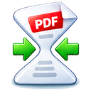

# PDF Minify — make PDFs smaller

<p align="center"></p>

Make PDFs smaller with a variety of filters, compression algorithms and
techniques, and extensive previews that give a quick overview of each one's
visual effect and file size. Every preview and size is the actual file you
would save.

## Install

Download the package for your system from the
[latest release](https://github.com/realcarbonneau/pdf-minify/releases);
its page lists what changed ([CHANGELOG.md](CHANGELOG.md)).

| Platform | Package |
|----------|---------|
| [Windows 10 and 11](#windows) | `pdf-minify_0.0.1_windows-x64-setup.exe` |
| [Windows (portable)](#windows) | `pdf-minify_0.0.1_windows-x64-portable.zip` |
| [Debian 13 (Trixie)](#linux) | `pdf-minify_0.0.1_debian-13-trixie_amd64.deb` |
| [Ubuntu 24.04 (Noble), Linux Mint 22](#linux) | `pdf-minify_0.0.1_ubuntu-24.04-noble_amd64.deb` |
| [Ubuntu 26.04 (Resolute)](#linux) | `pdf-minify_0.0.1_ubuntu-26.04-resolute_amd64.deb` |
| [macOS (Apple Silicon)](#macos) | `pdf-minify_0.0.1_macos-arm64.dmg` |
| [macOS (Intel)](#macos) | `pdf-minify_0.0.1_macos-intel.dmg` |

The Windows and Linux packages are for 64-bit PCs (x86-64).

### Windows

Run the installer. Windows warns that the app is not signed with a Microsoft
certificate: click **More info**, then **Run anyway**.

For the portable version, extract the `.zip` and run `PDF Minify.cmd`.

### macOS

Open the `.dmg` (Apple Silicon for M1 and later, Intel for older Macs) and
drag PDF Minify to Applications. On first launch macOS blocks it because it is
not notarized: open **System Settings → Privacy & Security** and click
**Open Anyway** next to the PDF Minify message. It needs macOS 14 (Sonoma) or
later.

### Linux

Install the downloaded package:

```bash
sudo apt install ./pdf-minify_0.0.1_debian-13-trixie_amd64.deb
```

Uninstall with `sudo apt remove pdf-minify`; your settings are kept.

### From source

On Debian 13:

```bash
sudo apt install git python3-venv jbig2 zopfli
git clone https://github.com/realcarbonneau/pdf-minify.git
cd pdf-minify
./setup_local.sh
./run.sh
```

### Opening the smaller PDFs

To save the most space, PDF Minify may store parts of a file with Brotli
compression, which older PDF readers (for example Evince and other
Poppler-based viewers) cannot display yet. If a file must open everywhere,
choose a Flate option under **PDF streams** before saving.

## Support

Report bugs or request features at GitHub Issues:
https://github.com/realcarbonneau/pdf-minify/issues

## License

PDF Minify is free software, licensed under the
[GNU Affero General Public License v3.0 or later](LICENSE).

Copyright (C) 2026 Real Carbonneau

Bundled third-party icons keep their own licenses; their notices are with
them in `pdf_minify/ui_qt/assets/`.

## Developers

Running from source, tests, building the packages, the design and the measured
benchmarks: [developer documentation](docs/README.md).
