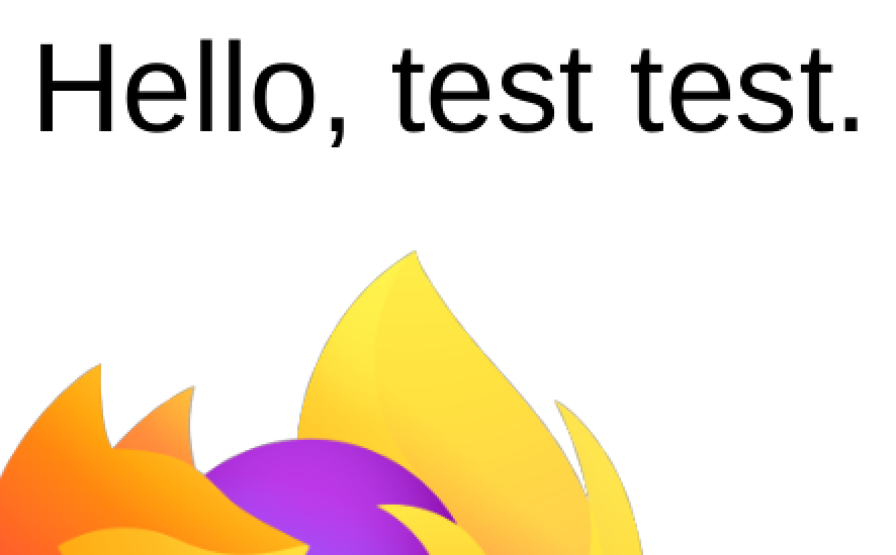
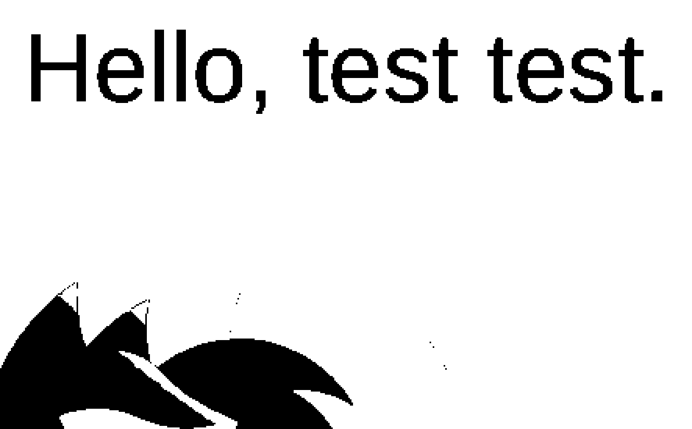

# Mixed mode vs forced raster — analysis (designer §121; SUPERSEDED §126)

> Designer §§126/127: the mixed-JPEG path was removed (never specified);
> Current §§168–171 supersede the intermediate in-place 1-bit implementation:
> FFPR OFF is one combined BW image canvas plus native text/vector overlays.
> See `COMPRESSION.md` for current measured results and layering policy. This
> analysis is kept as the measurement record of the removed wrong
> implementation — its tables show exactly what color-JPEGs-in-BW cost.

## Issues on this page

B50, B52 — see `issues.md` (gated log).

Designer questions (verbatim §121): why is the rasterized BW filter much
smaller than the text-keeping one on `images.pdf` — and why does zooming the
non-forced preview show text that does NOT look like the original ("Are you
keeping the text and rasterizing the whole image also?").

Short answers: the sizes are honest (measured below); the preview complaint
is a REAL bug — the mixed preview shows forced-style output, not what mixed
save produces. No code was changed for this analysis; §121 §B52 stay OPEN
for the designer's ruling on the options in §7.

## 1. Test file anatomy — `examples/images.pdf`

1 page (Letter), 1,494,439 bytes. 18 characters of real text ("Hello, test
test.", one subset font) plus FIVE photographic PNGs:

| xref | size | bytes |
|---|---|---|
| 12 | 1600×1608 | 649,271 |
| 13 | 500×504 | 13,022 |
| 14 | 1023×626 | 16,758 |
| 15 | 2980×2977 | 717,623 |
| 16 | 1361×702 | 18,283 |

Images total ≈ 1.41 MB = 94% of the file. The text layer is a few KB. Any
honest optimizer MUST shrink the images to shrink this file — and that is
where the whole size gap lives.

## 2. Benchmarks — what each mode saves (measured, not estimated)

`process_file(images.pdf, strategy=otsu)`, wall time on this machine:

| mode | wall time | file size |
|---|---|---|
| forced ON (full-page raster) | 0.7 s | 4,127 B |
| forced OFF (mixed, text passes) | 0.7 s | 178,766 B |

Object breakdown of the two outputs (sum of `/Image` stream bytes):

| mode | image streams | container+text+fonts | total |
|---|---|---|---|
| forced | 1 stream, 3,218 B (whole-page 1-bit JBIG2) | 909 B | 4,127 B |
| mixed | 10 streams, 171,023 B (5 JPEGs + 5 soft masks) | 7,743 B | 178,766 B |

Per-image planner replay (mixed): 649,271→48,663 · 13,022→12,630 ·
16,758→15,902 · 717,623→34,564 · 18,283→17,929. JPEG payload sums to
129,688 B — exactly the strip estimate (see §4).

Why raster is ~40× smaller here: the page is 94% photographic pixels.
Mixed mode keeps every photo photographic (JPEG q45/150dpi ≈ 129 KB) plus
their transparency masks (≈ 42 KB, see failure §5a). Forced mode thresholds
everything — photos included — to 1 bit and JBIG2 crushes the mostly-white
page to 3.2 KB. Text-as-characters IS smaller than text-as-bitmap (a
text-only 2-page doc measures 1,168 B mixed vs 2,714 B forced), but on THIS
file there is almost no text to save — the gap is all images.

## 3. "Are you keeping the text and rasterizing the whole image also?"

No — proven both halves on the mixed output:

- Text kept vector: `mixed[0].get_text()` returns `'Hello, test test.'`;
  fonts/content account for only ~7.7 KB of the file.
- No whole-page image: the mixed output holds exactly the 5 source images
  as 5 recompressed JPEGs (+ masks), each traceable to its source xref.
  Nothing is flattened.

Mixed SAVE = original page copied (`insert_pdf`), text untouched, each
image recompressed in place (`pipeline.py: _recompress_images`, JPEG q45
@150dpi). The forced SAVE = one 1-bit JBIG2 page image, zero text
(`forced[0].get_text()` returns `''`).

## 4. The preview side — where the real bug is

Both panes render fixed bitmaps at 150 dpi (`PREVIEW_DPI`); zoom is a
graphics-transform upscale, never a re-render (`viewer.py: set_zoom`).

- LEFT pane: 150 dpi grayscale render — anti-aliased, smooth.
- RIGHT pane, BW mixed: `preview_page` thresholds to pure 0/255 (verified:
  preview array unique values = `{0, 255}`) — staircase glyphs, photos as
  black blobs. Zoom magnifies both bitmaps, so the thresholded text falls
  apart while the grayscale original merely softens:

So the designer is right: the mixed preview does NOT look like the mixed
save. The preview shows what FORCED save would produce, while the save
keeps crisp vector text. Cause: §113 ("right pane always shows the full
filter effect") was implemented as "always threshold", which is only true
for forced mode. In mixed mode the filter's actual effect IS the original
text + compressed images.

## 5. Failures found (with evidence)

(a) The mixed estimator ignores soft-mask bytes. `estimate_mixed_page`
sums only `plan["stream"]` (129,688 B) but the save embeds 5 JPEGs + 5
SMasks (171,023 B) — a ~42 KB / 24% undercount on this file. Same blind
spot in `color_doc_total` (masks skipped outright). Fix: walk `get_images`
masks and add their (recompressed or kept) stream lengths. Not yet ruled —
proposed, awaiting §121 decision.

(b) Mixed preview contradicts mixed save (§4 above). The preview pipeline
has no mixed branch at all: `preview_page` thresholds whenever mode is BW.

## 6. Successes confirmed (with evidence)

- Estimator and saver share encoders (`bw_page_payload`, `color_stream_plan`):
  forced est 3,218 B → save 4,127 B; mixed est 129,688 B → save 178,766 B
  (gap = container + the §5a masks). No invented numbers.
- Toggle zero-churn holds (§116): amounts follow each filter's own recipe;
  the checkbox dispatches nothing (regression test fails pre-fix).
- JBIG2 ships only after a pixel-exact test-decode; undecodable pages take
  1-bit PNG (`bw_page_payload`) — the 3.2 KB stream above is validated,
  not a lucky artifact.

## 7. Options — needs the designer's ruling

- **A. Mixed preview = mixed save (WYSIWYG).** BW + force OFF shows the
  original text crisp, images as rendered (at 150 dpi the JPEG difference
  is nearly invisible). Preview matches save exactly; minis keep showing
  the raster recipe (§105 untouched).
- **B. Keep thresholded preview** (§113 literal). Preview keeps lying
  about mixed save; the zoom complaint stands.
- **C. Hybrid** (threshold non-text regions only): fragile, not recommended.

Recommendation: A — it resolves the zoom complaint without touching minis,
amounts, keys, or save; the §113 intent ("preview the selected filter")
is better served because the filter WITH force off does not threshold text.

## 8. Cross-references

- Issues: B36 (per-filter raster), B37 (toggle recalculated nothing →
  superseded), B39 (mini churn), B40 (sizes blank), B46 (BW preview
  wrong → §113 fix that caused §4's bug), B47 (toggle resized sizes),
  B50 (raster-vs-text question), B52 (this analysis).
- Rulings: §§103/105/106/111/113/116/119/121.
- TODO: items 103/105/106/113/116/119/121.
- Code: `pipeline.py: process_file` (mixed branch), `_recompress_images`,
  `bw_page_payload`, `color_stream_plan`; `ui_qt/jobs.py: preview_page`,
  `estimate_mixed_page`, `color_doc_total`, `PREVIEW_DPI`;
  `ui_qt/viewer.py: set_zoom` (upscale-only); `ui_qt/app.py:
  _render_all` (150 dpi baseline).
- Repro scripts (kept out of the repo): `/tmp/opencode/measure_force.py`,
  `/tmp/opencode/breakdown.py`, `/tmp/opencode/proof_crops.py`.
